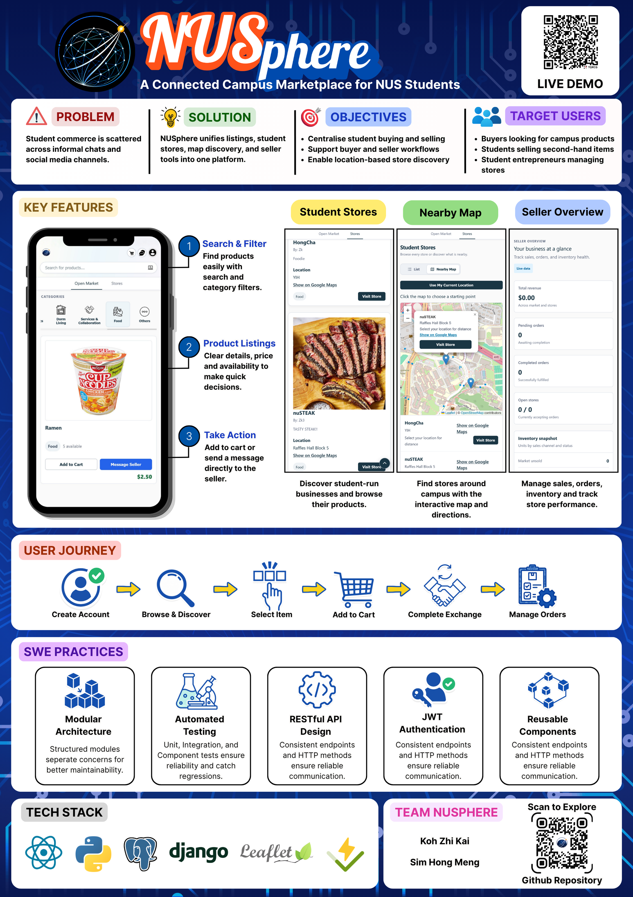

# NUSphere

<p align="center">
  
</p>

[View the detailed project readme (PDF)](NUSPhere_DetailedReadMe.pdf)

NUSphere is a campus marketplace for buying, selling, and discovering products and student-run stores. It brings listings, store pages, location-aware browsing, carts, orders, and buyer–seller messaging together in one web app.

## What you can do

- Browse and create marketplace listings.
- Discover stores and their products, with map-based location browsing.
- Register, sign in, and manage a profile.
- Add products to a cart and manage orders.
- Message other users about listings and purchases.
- Create and manage a personal store.

## Tech stack

- **Frontend:** React, Vite, React Router, Leaflet
- **Backend:** Django, Django REST Framework, JWT authentication
- **Data and uploads:** PostgreSQL in deployment; SQLite for local development; Cloudinary for persistent uploaded images

## Run locally

Prerequisites: Python 3.12 or later, Node.js 22.12 or later, and npm.

### Start the backend

In a terminal from the repository root:

```sh
cd NUSphereBackend
python3 -m venv .venv
source .venv/bin/activate
pip install -r requirements.txt
DEBUG=True python manage.py migrate
DEBUG=True python manage.py runserver
```

The API runs at `http://localhost:8000`. When `DATABASE_URL` is not set, Django uses a local SQLite database at `NUSphereBackend/db.sqlite3`.

On Windows PowerShell, activate the environment with `.venv\Scripts\Activate.ps1` instead of `source .venv/bin/activate`.

### Start the frontend

In a second terminal:

```sh
cd NUSphereFrontEnd
npm ci
npm run dev
```

Open the local URL printed by Vite (usually `http://localhost:5173`). The frontend uses `http://localhost:8000` as its API by default. To use another API URL, set `VITE_API_URL` in the frontend environment before starting or building the app.

## Deploy

The repository includes a Render Blueprint for the React site and Django API. The recommended hobby setup uses Neon for PostgreSQL and Cloudinary for persistent image uploads.

Follow [DEPLOYMENT.md](DEPLOYMENT.md) for the setup steps, environment variables, and free-tier behavior.

## Repository layout

```text
NUSphereFrontEnd/   React and Vite application
NUSphereBackend/    Django API and database models
render.yaml         Render service configuration
DEPLOYMENT.md       Hobby deployment guide
```
